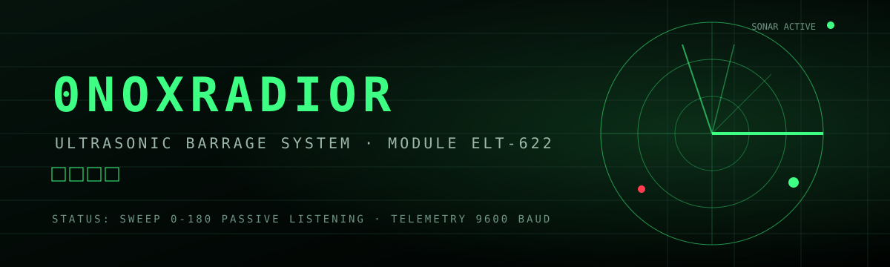

<p align="center">
  
</p>

<h1 align="center">0NOXRADIOR</h1>

<p align="center">
  Tactical ultrasonic radar simulator with 0–180&deg; servo sweep, echo persistence, serial / network telemetry and a military-grade operator console. Runs in the browser, works with a real Arduino or with no hardware at all.
</p>

<p align="center">
  
  
  
  
  
  
  
  
  
  
</p>

---

## About

**0NOXRADIOR** is a browser-based radar console that emulates an ultrasonic surveillance station. A virtual servo sweeps 0–180&deg; while an HC-SR04-style sensor reports distances; detected contacts are drawn as glowing echoes with realistic persistence — exactly like a NATO-style PPI display.

The project is designed to be **source-agnostic**. You can feed the radar from four different sources, from a pure in-browser simulation to a real microcontroller:

1. **Simulation** — built-in targets, sensor noise and sync, zero hardware required.
2. **Real serial (Web Serial)** — plug in an Arduino with the HC-SR04 + servo and stream live readings from the browser.
3. **Simulated serial** — if no physical serial port is available, the SERIAL mode self-falls back to a virtual Arduino with identical RX/log/link behaviour.
4. **Network (WebSocket)** — a Python bridge publishes telemetry so any device on the LAN can render the same radar (command-room style).

## Features

| Feature | Description |
|---|---|
| **Radar console** | 0–180&deg; sweep, echo persistence/fading, grid + bearing rings, real-time header telemetry. |
| **Simulation mode** | Demo targets, sensor noise, synchronized barrido and local fallback sweep when serial is idle. |
| **Real serial** | Native Web Serial (Chrome/Edge, secure context) at 9600 baud, stream format `angle,distance`. |
| **Simulated serial fallback** | Automatic stand-in Arduino when no real port exists — same RX lines, same sync, same LINK status. |
| **Network mode** | WebSocket client, connect to any `ws://` bridge (`radar_bridge.py` / `radar_bridge_puro.py`) or an autonomous ESP32 node. |
| **Red Alert protocol** | One click activates sirens, red screen overlay, radio silence and a merit award. |
| **Field merits** | Gamified achievements (98 entries in `js/logros.json`) with random soldier awards from `img/`, cooldown-protected. |
| **Targets & telemetry** | Users can define objectives (`angle,distance`), add radar objects and track detections. |
| **Audio** | Radar pings, alarm and radio ambience (`sound/`). |
| **Landing page** | Professional military landing (`index.html`) with tactical film archive and sensor-styled gallery. |

## Tech Stack

| Area            | Technology                                                       |
| --------------- | ---------------------------------------------------------------- |
| Frontend        | HTML5, CSS3, Vanilla JavaScript (ES2020+)                        |
| Serial          | Web Serial API (secure context: `localhost` / HTTPS)             |
| Networking      | WebSocket (client + Python bridge server)                        |
| Firmware        | Arduino (HC-SR04 + SG90) and ESP32 standalone firmware           |
| Bridge / tooling| Python 3 (stdlib-only mode or `websockets` library)              |
| Hosting         | Netlify                                                          |

## Hardware

### Arduino node (USB)

Firmware: [`arduino/radar_ultrasonico.ino`](arduino/radar_ultrasonico.ino)

- Servo on the sweep pin, HC-SR04 TRIG/ECHO, streaming `angle,distance` at 9600 baud.
- Flash it, open the app (Chrome/Edge), press **SERIAL → CONNECT → BUSCAR**, pick the Arduino port and let the link sync.

### ESP32 node (headless, no PC)

Firmware: [`arduino/radar_esp32_ws.ino`](arduino/radar_esp32_ws.ino)

- Sweeps, measures and serves its **own radar UI** over WiFi (mDNS `http://radar.local`, WebSocket on `:81`, requires the *WebSockets by Markus Sattler* library).
- Any device on the network can open the URL and watch the same station — no Python, no serial drivers, no com0com.

## Getting Started

### Prerequisites

- A modern browser: **Chrome or Edge** (Web Serial requires a secure context: `localhost` or HTTPS).
- (Optional) **Python 3** for the network bridge.
- (Optional) An **Arduino/ESP32** for real hardware.

### Run locally

```bash
git clone https://github.com/0noxtackore/0noxRadior.git
cd 0noxRadior

# serve the site (any static server works)
python -m http.server 8000 --bind 0.0.0.0
```

Open:

- Landing page → `http://127.0.0.1:8000`
- Simulator    → `http://127.0.0.1:8000/radar.html`

### Environment / data sources

| Source | How to enable |
|---|---|
| Simulation | Just open the app and press **SIMULACIÓN**. |
| Simulated serial | **SERIAL → CONNECT → SERIAL SIMULADO** — behaves like a real Arduino feeding the port. |
| Real serial | Connect the Arduino via USB → **SERIAL → CONNECT → BUSCAR** → select the port. |
| Network | Run a bridge (below) and connect via **RED → WebSocket URL**. |

### Serial bridge (multi-device)

Publish telemetry to the LAN with the stdlib-only bridge (single command, no extra Python packages):

```bash
python radar_bridge_puro.py COM6 9600 8000
# page:      http://127.0.0.1:8000
# telemetry: ws://127.0.0.1:8765
```

Or the `websockets`-based bridge:

```bash
pip install websockets
python radar_bridge.py   # reads COM5 by default, broadcasts on ws://0.0.0.0:8765
```

To simulate sensor data into a port (for testing the bridge on any machine):

```bash
python enviar_radar.py COM5 9600
```

> **Multi-device demo:** devices open `http://<PC-IP>:8000` and connect the RADAR to `ws://<PC-IP>:8765`. Note firewall ports 8000/8765, and remember **https pages cannot open plain `ws://`** (mixed content) — use the local `http://` URL for LAN demos, or an `wss://`/ESP32 node from Netlify.

## Project Structure

```
0noxRadior/
├── index.html                 # Professional landing page (military style)
├── radar.html                 # The radar simulator app
├── css/
│   ├── style.css              # Radar console theme
│   └── landing.css            # Landing page theme
├── js/
│   ├── script.js              # Console logic: sweep, serial, WS, merits, alerts
│   └── logros.json            # 98 field merits for the gamification system
├── img/
│   ├── banner.svg             # README / cover banner
│   ├── submarino.svg          # Tactical submarine asset
│   ├── s1.avif … s5.webp      # Soldier award images (random merits)
│   └── landing-page/          # Tactical film archive gallery (12 images)
├── sound/
│   ├── radar.mp3              # Radar ping
│   ├── alerta.mp3             # Red alert siren
│   └── radio.mp3              # Radio ambience
├── arduino/
│   ├── radar_ultrasonico.ino  # Arduino USB node (HC-SR04 + SG90)
│   └── radar_esp32_ws.ino     # ESP32 autonomous wireless node
├── radar_bridge.py            # WebSocket bridge (websockets lib)
├── radar_bridge_puro.py       # Single-command stdlib bridge (HTTP + WS)
├── enviar_radar.py            # Simulated Arduino serial feed
└── README.md
```

## Deployment

### Netlify (recommended)

1. Push the repo and connect it in Netlify: *New site from Git*.
2. Build command: *(none — static site)*.
3. Publish directory: `root`.
4. *Deploy site*.

The landing page is served at the root and the simulator at `/radar.html`.

### Manual (any static host)

```bash
python -m http.server 8000
# or upload the folder to Apache, Nginx, Vercel, Cloudflare Pages, GitHub Pages…
```

## Live Demo

- Site: **https://0noxradior.netlify.app/**
- Simulator: **https://0noxradior.netlify.app/radar.html**

## License

[MIT](LICENSE) &copy; 2026 0noxtackore

---

<p align="center">
  Built by <a href="https://github.com/0noxtackore">0noxtackore</a> · SYS-0X · ELT-622
</p>